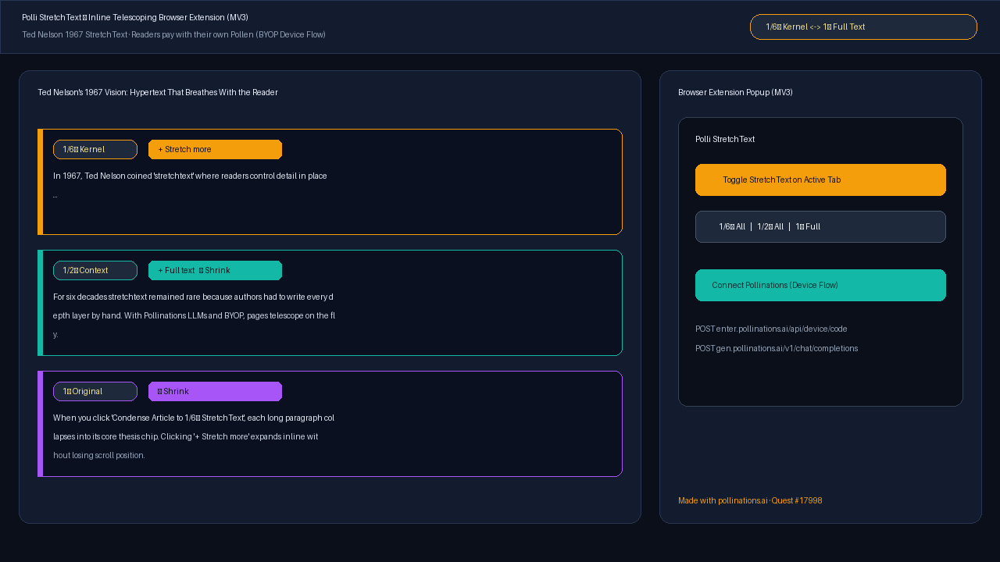

# Polli StretchText — Inline Telescoping Browser Extension

**Live Interactive Demo & Install Guide:** [https://brutus88ai.github.io/polli-stretchtext/](https://brutus88ai.github.io/polli-stretchtext/)  
**Quest:** [pollinations/pollinations#17998](https://github.com/pollinations/pollinations/issues/17998)

Polli StretchText is a Manifest V3 browser extension (plus interactive web reader demo) that turns any web page into **Ted Nelson's 1967 stretchtext**: condense any article to ~1/6th of its words in place, then click inline `+ Stretch more` / `+ Full text` / `− Shrink` chips to expand where you want detail and shrink back where you don't — with readers paying with their own Pollen (**BYOP**).

## Features

- **In-Place Telescoping Levels (`1/6× Kernel` → `1/2× Context` → `1× Original`)**:
  - Works directly inside the current page's DOM layout (`content.js`), inspired by [cc-stretch](https://github.com/aguilarcarboni/cc-stretch).
- **Bring Your Own Pollen (BYOP) Device Flow & `<polli-connect>`**:
  - Extension popup uses the official Pollinations OAuth 2.0 Device Authorization Grant (`POST https://enter.pollinations.ai/api/device/code` & `POST https://enter.pollinations.ai/api/device/token`).
  - Web demo page integrates `<polli-connect>` (`@pollinations/ui`).
- **Zero-Pollen Local Telescoping Fallback**:
  - Includes a deterministic sentence/clause telescoping engine and local storage cache so readers can try inline stretchtext immediately with 0 Pollen.

## Load Unpacked Extension (Chrome / Edge / Brave)

1. Clone this repository: `git clone https://github.com/Brutus88Ai/polli-stretchtext.git`
2. Open `chrome://extensions`, enable **Developer mode**, click **Load unpacked**, and select the repo directory.
3. Click the **Polli StretchText** toolbar icon on any article to condense and stretch paragraphs in place.
